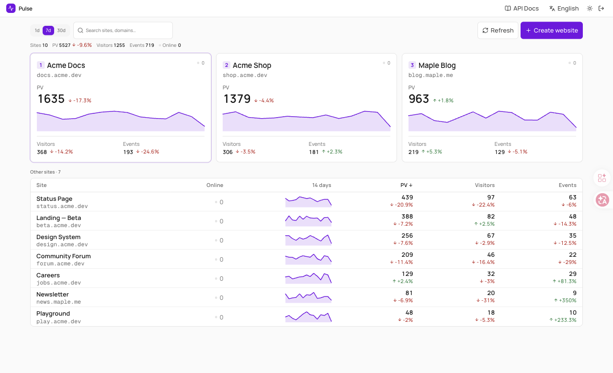
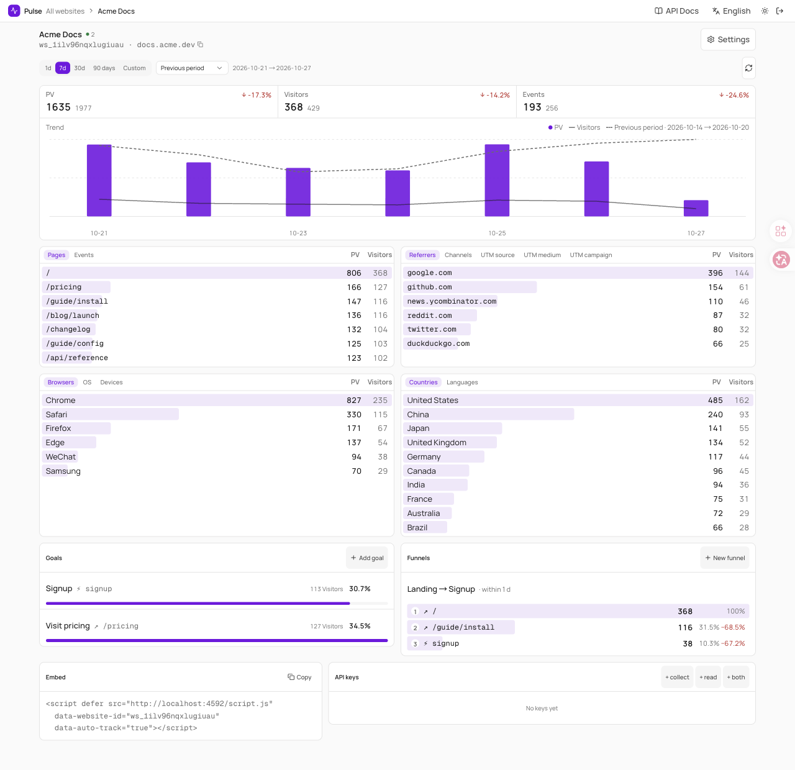
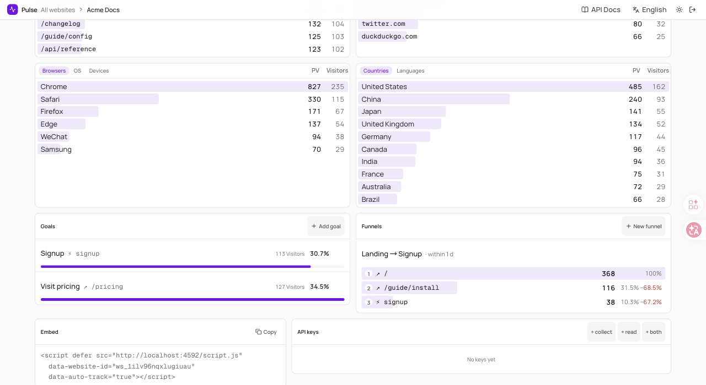

# Pulse

**Lightweight, API-key-first web analytics.** Pageviews, events, traffic sources, devices, goals and funnels — in one small self-hosted service backed by a single SQLite file. A compact alternative to Umami, built so people *and* AI agents can read the numbers.

English · [简体中文](./README.zh-CN.md)



> Screenshots use generated demo data (`scripts/seed-demo.mjs`).

## Features

- **Everything is an API.** Every page of the UI is backed by `/v1/*` with scoped API keys (`collect`, `read`, `admin`), OpenAPI at `/v1/openapi.json`, and a short [agent guide](./docs/AGENT.md).
- **Traffic sources.** Referrer host, channel (direct, organic search, social, referral, email, paid, campaign) and UTM source / medium / campaign. A session's first hit decides the source for the whole session, so events and goals can be filtered by channel too.
- **Audience.** Browser, OS, device, country and language. No IP address and no raw user-agent is stored.
- **Global filters.** Click any row to filter every number, chart, goal and funnel on the page — and the same filters work in the API.
- **Goals and funnels.** Event or page goals with conversion rate; ordered funnels with a per-step time window.
- **Compare.** Previous period or same period last year, with a custom date range.
- **Per-site timezone** for day boundaries; changing it re-buckets history.
- **Read-only share links** so you can show a site's stats without sharing a key.
- **Data retention.** Per-site or global cleanup of raw events (daily totals are kept), manual cleanup, one-click site deletion.
- **Small and private.** One SQLite file, no third-party requests, crawlers ignored. The tracker sets no cookies — it keeps a random anonymous id in `localStorage`.
- **Bilingual UI** (English / 简体中文), light and dark.

| Report | Goals and funnels |
| --- | --- |
|  |  |

## Quick start (Docker)

```bash
git clone https://github.com/k7airos/pulse.git && cd pulse
docker compose up -d
docker compose exec pulse cat /data/BOOTSTRAP_ADMIN_KEY.txt   # your admin key
```

Open <http://127.0.0.1:4592>, paste the key, **Create website**, and add the snippet it shows you to your site:

```html
<script defer src="https://pulse.example.com/script.js"
  data-website-id="ws_xxxxxxxx" data-auto-track="true"></script>
```

Data lives in the `pulse-data` volume. The port is bound to `127.0.0.1`; put a reverse proxy with HTTPS in front for real use, for example Caddy:

```
pulse.example.com {
	reverse_proxy 127.0.0.1:4592
}
```

Then set `PULSE_TRUST_PROXY=1` (see below) so rate limiting sees real client IPs.

### Without Docker

```bash
pnpm install
pnpm build
PULSE_DATA_DIR=./.data PORT=4592 node .output/server/index.mjs
```

Node 22+ and pnpm are required. `pnpm dev` starts the dev server on port 4592.

## Configuration

| Variable | Description |
| --- | --- |
| `PULSE_DATA_DIR` | Directory of the SQLite database (default `./.data`, `/data` in Docker) |
| `PULSE_BOOTSTRAP_ADMIN_KEY` | Fixed admin key for the first start (>= 24 characters). Otherwise one is generated into `BOOTSTRAP_ADMIN_KEY.txt` |
| `PULSE_TRUST_PROXY` | `1` when a trusted reverse proxy sets `X-Forwarded-For` / `X-Real-IP`. Leave `0` when exposed directly |
| `PULSE_ENFORCE_ORIGIN` | `0` disables checking the browser `Origin` against each website's registered domain |
| `PULSE_RETENTION_DAYS` | Default retention for raw events in days (`0` = forever). Each site can override it in Settings |
| `PORT` / `HOST` | Listen port / address (Docker image: `3000` / `0.0.0.0`) |

Countries come from `CF-IPCountry`, `X-Vercel-IP-Country` or `X-Country-Code` when present, otherwise from a bundled IP-to-country table.

## Tracking

- **Script tag:** `window.pulse.track('signup', { plan: 'pro' })` sends a custom event; `data-do-not-track="true"` honours the browser's DNT setting.
- **Nuxt:** the module in [`modules/nuxt-pulse`](./modules/nuxt-pulse) adds automatic page views and `trackPulseEvent`.
- **Server side:** `POST /v1/collect` or `/v1/collect/batch` with a `collect` key.

## API in 30 seconds

```bash
export PULSE=http://127.0.0.1:4592 KEY=pk_live_…

curl -s "$PULSE/v1/overview" -H "x-api-key: $KEY"                                  # every site at a glance
curl -s "$PULSE/v1/websites/$ID/report?days=7&compare=prev" -H "x-api-key: $KEY"   # the whole report
curl -s "$PULSE/v1/websites/$ID/breakdown?by=channel&days=30&device=mobile" -H "x-api-key: $KEY"
```

See [docs/API.md](./docs/API.md) and [docs/AGENT.md](./docs/AGENT.md). Coming from Umami? [docs/MIGRATE_FROM_UMAMI.md](./docs/MIGRATE_FROM_UMAMI.md).

## Privacy and security

- Browser collection is accepted only from the website's registered domain; request sizes, ranges and filters are validated; rate limits and brute-force lockouts are on.
- Only derived values are stored: no IP address, no raw user-agent, no query strings in page paths. The tracker uses a random anonymous id in `localStorage` instead of cookies.
- See [SECURITY.md](./SECURITY.md) to report a vulnerability and [the 0.2.0 audit](./docs/SECURITY-AUDIT-2026-10-26.md).

## Development

```bash
pnpm install
pnpm dev                                            # http://localhost:4592
node scripts/seed-demo.mjs http://127.0.0.1:4592 <admin-key>   # generated demo data
```

Nuxt 4, Nuxt UI, better-sqlite3, Drizzle (schema), Zod. The UI uses [`@akairos/design`](https://www.npmjs.com/package/@akairos/design) tokens.

## License

[MIT](./LICENSE)
