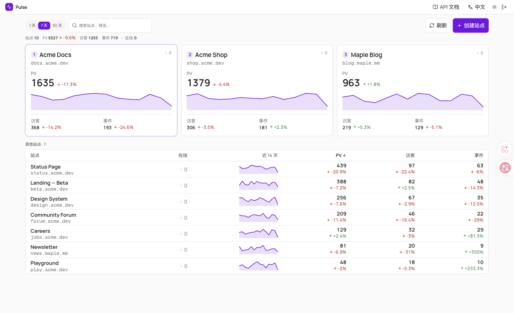
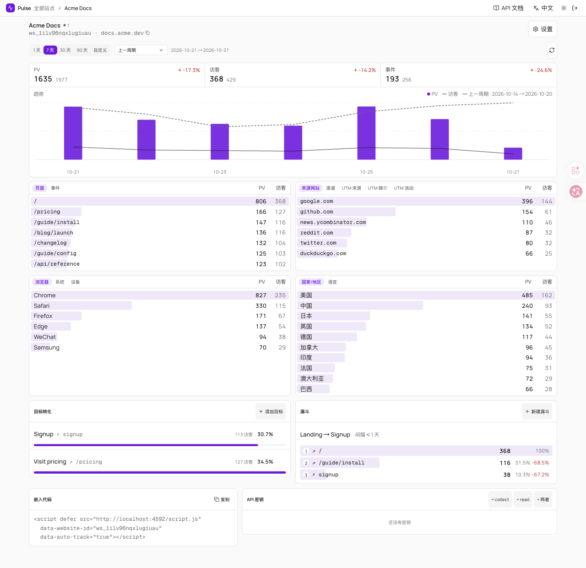
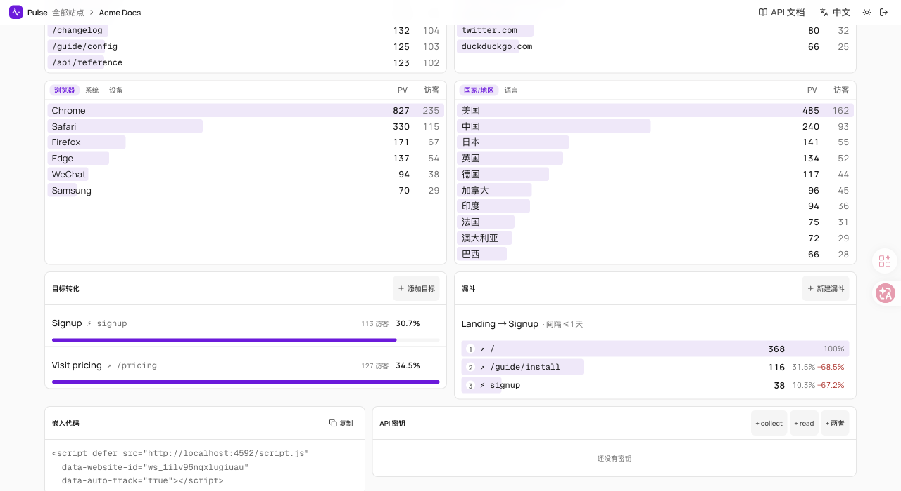

# Pulse

**轻量、API Key 优先的网站统计。** 浏览量、事件、流量来源、设备、目标和漏斗，全部装在一个小型自托管服务里，数据只存一个 SQLite 文件。可以当作 Umami 的轻量替代，并且从设计上就让人和 AI Agent 都能读到数据。

[English](./README.md) · 简体中文



> 截图使用脚本生成的演示数据（`scripts/seed-demo.mjs`）。

## 功能

- **一切皆 API。** 界面上每个页面都由 `/v1/*` 提供，API Key 分 `collect` / `read` / `admin` 三种权限，OpenAPI 在 `/v1/openapi.json`，另有简短的 [Agent 指南](./docs/AGENT.md)。
- **流量来源。** 来源网站、渠道（直接访问、自然搜索、社交、外部引荐、邮件、付费、其他活动）和 UTM 来源 / 媒介 / 活动。会话的第一次访问决定整个会话的来源，所以事件和目标也能按渠道筛选。
- **访客画像。** 浏览器、系统、设备、国家/地区、语言。不保存 IP，也不保存原始 User-Agent。
- **全局筛选。** 点任意一行，页面上所有数字、图表、目标和漏斗一起联动；API 同样支持。
- **目标和漏斗。** 事件或页面目标及转化率；按顺序的漏斗，可设步骤间最长间隔。
- **对比。** 上一周期或去年同期，也可自定义日期范围。
- **每个站点独立时区**，决定"按天"的分界线；修改时区会重算历史。
- **只读分享链接**，不用交出 Key 就能展示某个站点的数据。
- **数据保留。** 站点级或全局清理明细事件（每日汇总保留），支持手动清理和一键删除站点。
- **小而私密。** 单个 SQLite 文件，不请求第三方，自动忽略爬虫。埋点脚本不设 Cookie，只在 `localStorage` 里保存一个随机的匿名 ID。
- **中英双语界面**，支持浅色和深色。

| 报表 | 目标与漏斗 |
| --- | --- |
|  |  |

## 快速开始（Docker）

```bash
git clone https://github.com/k7airos/pulse.git && cd pulse
docker compose up -d
docker compose exec pulse cat /data/BOOTSTRAP_ADMIN_KEY.txt   # 管理员 Key
```

打开 <http://127.0.0.1:4592>，粘贴 Key，点「创建站点」，把页面给出的代码片段放进你的网站：

```html
<script defer src="https://pulse.example.com/script.js"
  data-website-id="ws_xxxxxxxx" data-auto-track="true"></script>
```

数据保存在 `pulse-data` 卷里。端口默认只绑定 `127.0.0.1`，正式使用请在前面放一个带 HTTPS 的反向代理，例如 Caddy：

```
pulse.example.com {
	reverse_proxy 127.0.0.1:4592
}
```

然后设置 `PULSE_TRUST_PROXY=1`（见下表），让限流按真实客户端 IP 计算。

### 不用 Docker

```bash
pnpm install
pnpm build
PULSE_DATA_DIR=./.data PORT=4592 node .output/server/index.mjs
```

需要 Node 22+ 和 pnpm。`pnpm dev` 会在 4592 端口启动开发服务。

## 配置

| 变量 | 说明 |
| --- | --- |
| `PULSE_DATA_DIR` | SQLite 数据库目录（默认 `./.data`，Docker 里是 `/data`） |
| `PULSE_BOOTSTRAP_ADMIN_KEY` | 首次启动使用的固定管理员 Key（至少 24 位）。不设置则自动生成并写入 `BOOTSTRAP_ADMIN_KEY.txt` |
| `PULSE_TRUST_PROXY` | 前面有可信反向代理（会设置 `X-Forwarded-For` / `X-Real-IP`）时设为 `1`；直接暴露时保持 `0` |
| `PULSE_ENFORCE_ORIGIN` | 设为 `0` 则不再校验浏览器上报的 `Origin` 是否属于站点登记的域名 |
| `PULSE_RETENTION_DAYS` | 明细事件的默认保留天数（`0` 为永久）。每个站点可在设置里单独覆盖 |
| `PORT` / `HOST` | 监听端口 / 地址（Docker 镜像里是 `3000` / `0.0.0.0`） |

国家/地区优先读取 `CF-IPCountry`、`X-Vercel-IP-Country` 或 `X-Country-Code`，没有时使用内置的 IP 到国家对照表。

## 埋点

- **脚本标签：** `window.pulse.track('signup', { plan: 'pro' })` 发送自定义事件；加上 `data-do-not-track="true"` 会遵守浏览器的"请勿跟踪"设置。
- **Nuxt：** [`modules/nuxt-pulse`](./modules/nuxt-pulse) 提供自动页面浏览和 `trackPulseEvent`。
- **服务端：** 用 `collect` 权限的 Key 调用 `POST /v1/collect` 或 `/v1/collect/batch`。

## 30 秒看懂 API

```bash
export PULSE=http://127.0.0.1:4592 KEY=pk_live_…

curl -s "$PULSE/v1/overview" -H "x-api-key: $KEY"                                  # 所有站点一览
curl -s "$PULSE/v1/websites/$ID/report?days=7&compare=prev" -H "x-api-key: $KEY"   # 整页报表
curl -s "$PULSE/v1/websites/$ID/breakdown?by=channel&days=30&device=mobile" -H "x-api-key: $KEY"
```

详见 [docs/API.md](./docs/API.md) 和 [docs/AGENT.md](./docs/AGENT.md)。从 Umami 迁移请看 [docs/MIGRATE_FROM_UMAMI.md](./docs/MIGRATE_FROM_UMAMI.md)。

## 隐私与安全

- 浏览器上报只接受站点登记域名的来源；请求大小、时间范围和筛选条件都经过校验；有限流和暴力破解锁定。
- 只保存派生值：不存 IP、不存原始 User-Agent，页面路径不含查询参数。埋点用 `localStorage` 里的随机匿名 ID，不用 Cookie。
- 报告漏洞请看 [SECURITY.md](./SECURITY.md)；另有 [0.2.0 安全审计](./docs/SECURITY-AUDIT-2026-10-26.md)。

## 开发

```bash
pnpm install
pnpm dev                                            # http://localhost:4592
node scripts/seed-demo.mjs http://127.0.0.1:4592 <admin-key>   # 生成演示数据
```

技术栈：Nuxt 4、Nuxt UI、better-sqlite3、Drizzle（表结构）、Zod。界面使用 [`@akairos/design`](https://www.npmjs.com/package/@akairos/design) 的设计令牌。

## 许可证

[MIT](./LICENSE)
